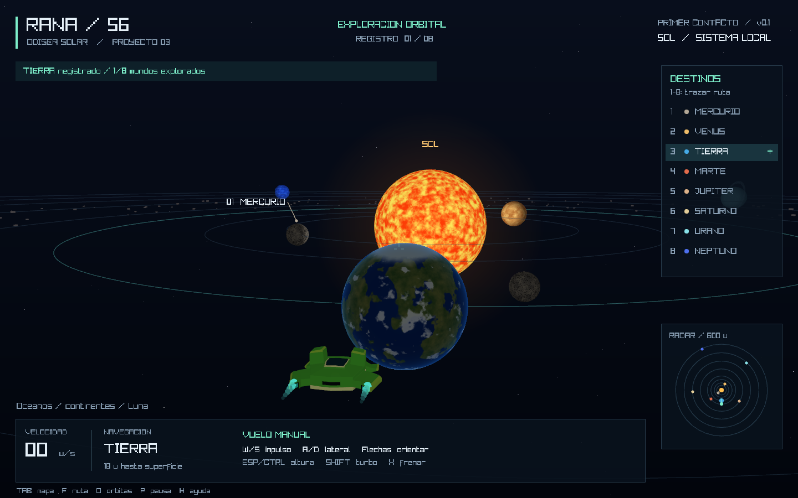

# RANA / 56 — Odisea Solar

**Proyecto 3 · Primera versión jugable**
Juan Jose Rivas Alvarez · Carnet 24856

Exploración espacial en **Rust y raylib 6.0.0**, con la nave RANA-56 creada en Blender para el Laboratorio 3. La cámara sigue la nave y permite recorrer el sistema solar en vuelo libre o con piloto automático.



## Escenario

- Sol animado con iluminación sobre los planetas.
- Mercurio, Venus, Tierra, Marte, Júpiter, Saturno, Urano y Neptuno, cada uno con superficie procedural propia.
- Continentes, océanos, nubes y casquetes para la Tierra; bandas para los gigantes gaseosos; anillos para Saturno y Urano.
- Luna y cinturón de asteroides decorativo.
- Órbitas y rotación animadas, fondo de estrellas y vista general del sistema.
- Nave original en OBJ con los siete materiales de color base y estelas de los motores.
- Radar, selección de destinos, indicador de velocidad y registro de ocho mundos explorados.

Las dimensiones, distancias y velocidades son **escalas artísticas para jugar**, no una simulación astronómica a escala real. Los asteroides son decorativos; el Sol, los planetas y la Luna sí impiden atravesar su superficie. La exploración se conserva durante la sesión y se reinicia al cerrar el juego.


## Jugar

Se inicia cerca de la Tierra. Acércate a cada planeta para registrar una visita. Las teclas **1 a 8** activan una ruta automática al destino correspondiente; cualquier entrada de movimiento devuelve el control manual.

| Control | Acción |
| --- | --- |
| W / S | Impulso hacia adelante / atrás |
| A / D | Desplazamiento lateral |
| Flechas izquierda / derecha | Girar la nave |
| Flechas arriba / abajo | Inclinar el rumbo |
| Espacio / Ctrl izquierdo | Subir / bajar |
| Shift izquierdo | Turbo |
| X | Frenar |
| 1–8 | Viajar a Mercurio–Neptuno |
| F | Iniciar o cancelar ruta al destino seleccionado |
| Tab | Alternar mapa general y tercera persona |
| O | Mostrar u ocultar órbitas |
| P | Pausar o continuar la simulación |
| R | Volver al inicio manteniendo el registro de visitas de la sesión |
| H | Mostrar u ocultar ayuda |
| F12 | Guardar `screenshots/captura.png` |
| Escape | Salir |

El piloto automático asciende a un plano de crucero, viaja sobre las órbitas y desciende cerca del planeta. Sigue su posición mientras avanza la simulación. El vuelo manual tiene aceleración suave, frenado y protección contra colisiones con cuerpos celestes.

## Compilar

Requisitos:

- Rust 1.88 o posterior y Cargo.
- CMake y herramientas de compilación C/C++ para construir raylib.
- LLVM/libclang para los bindings nativos.
- GPU/controlador compatible con OpenGL 3.3.

En Windows, usar Visual Studio 2022 con la carga de trabajo de C++, CMake y LLVM. Desde esta carpeta:

```powershell
cargo run --release
```

Si CMake o libclang no están en las rutas de búsqueda, el script de ayuda localiza las instalaciones habituales de Visual Studio y LLVM:

```powershell
.\jugar.ps1
```

La primera compilación necesita descargar las dependencias de Cargo. Se incluye `Cargo.lock` para fijar las versiones. No es necesario tener Blender instalado para ejecutar el juego.

Para llevar el ejecutable a otra carpeta, copiar `target/release/rana-solar.exe` **junto a la carpeta `assets`**. El OBJ y el MTL deben conservar sus nombres. Los shaders se incluyen en el ejecutable al compilar.

## Capturas reproducibles

```powershell
cargo run --release -- --hidden --frames 8 --capture screenshots/vuelo.png
cargo run --release -- --hidden --frames 8 --overview --capture screenshots/sistema.png
cargo run --release -- --hidden --frames 8 --planet 6 --capture screenshots/saturno.png
```

`--hidden` crea una ventana oculta, pero sigue necesitando un contexto gráfico OpenGL. `--planet 1..8` coloca la nave junto a un planeta para inspección visual. La navegación normal del juego utiliza el piloto automático, sin teletransportar la nave.

## Código

| Archivo | Responsabilidad |
| --- | --- |
| `src/main.rs` | Ventana, teclado, bucle, cámara y capturas. |
| `src/simulation.rs` | Órbitas, vuelo, colisiones, rutas y visitas. |
| `src/scene.rs` | Modelos, estrellas, anillos, radar e interfaz. |
| `assets/shaders/world.vs` | Transformación de vértices y normales. |
| `assets/shaders/world.fs` | Superficies procedurales, iluminación y atmósferas. |
| `assets/RANA_56.obj` | Malla original de la nave rana. |

## Verificación

```powershell
cargo test --release
cargo clippy --release -- -D warnings
cargo fmt --check
```

Las pruebas cubren las ocho órbitas, colisiones, llegada del piloto automático a cada planeta, cancelación manual, pausa, consistencia del movimiento entre tasas de cuadros y proyección de la cámara. Las capturas se obtienen del juego ejecutándose con sus shaders reales.

Tecnología: [raylib](https://www.raylib.com/) y [raylib-rs](https://github.com/raylib-rs/raylib-rs). Todo el escenario se genera en código; no se descargan texturas durante el juego.
