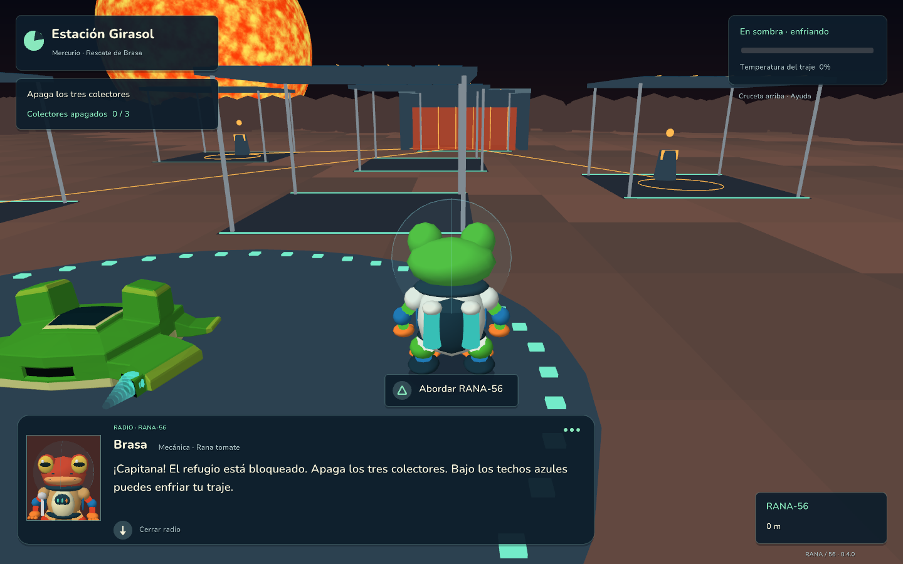
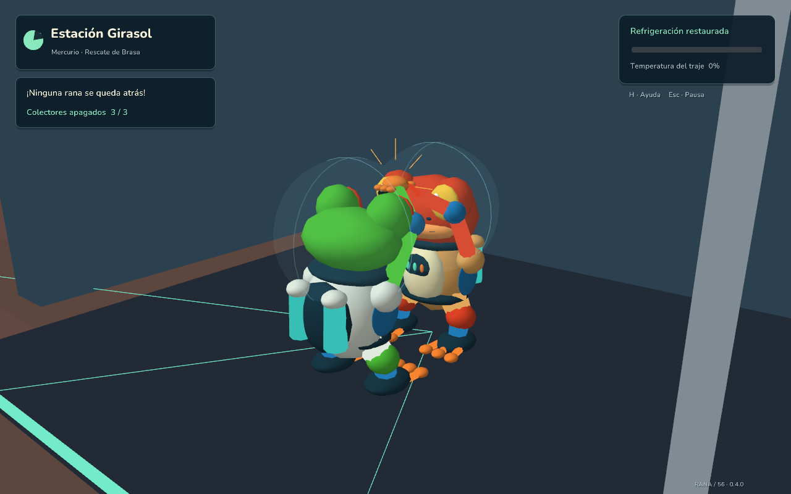
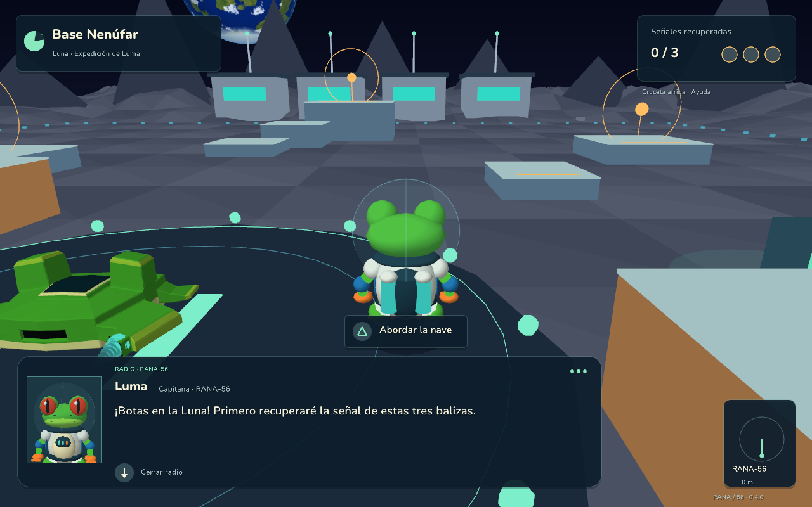

# RANA / 56 — Operación Croac

**Proyecto 3 · Versión 0.4.0 · Primer rescate en Mercurio**

Juan Jose Rivas Alvarez · Carnet 24856

Aventura del sistema solar en **Rust y raylib 6.0.0**. Pilota la RANA-56 y explora a pie con **Luma**, una rana de árbol de ojos rojos. En esta versión podrás rescatar a **Brasa**, una rana tomate mecánica atrapada en Mercurio.



## Jugar la versión 0.4

La carpeta local **`dist/RANA56-v0.4.0/`** contiene el ejecutable, los recursos y las instrucciones. Cada versión conserva su carpeta independiente.

- **`rana-solar.exe`**: empieza en el sistema solar, con Mercurio seleccionado.
- **`PrimerRescate.cmd`**: empieza directamente a pie en Mercurio.
- **`ExplorarLaLuna.cmd`**: entra al circuito lunar de entrenamiento.

Conserva `assets` junto al ejecutable. Las versiones se publican como [releases de GitHub](https://github.com/Juanjoo-Alvarez/Proyecto3-RANA56-SistemaSolar/releases), sin generar ni adjuntar ZIP propios. Para construir el juego desde GitHub, sigue la sección Compilar.

## Misión: ninguna rana se queda atrás

1. Pulsa **Triángulo / F** para trazar una ruta a Mercurio. Puedes elegir los demás destinos con L1/R1 o [ y ]; **1** traza la ruta directa a Mercurio.
2. Al llegar, pulsa **X / E** para descender. El vuelo manual necesita proximidad y velocidad inferior a 8 u/s. Luma sale de la nave automáticamente.
3. Busca los **tres colectores**, identificados por consolas doradas y techos azules. Cerca de cada uno, pulsa **Triángulo / E** para apagarlo.
4. Vigila la temperatura. Las sombras bajo los techos y el área de la nave enfrían el traje. Al sobrecalentarte, vuelves al punto de partida y conservas los colectores apagados. Apagar los tres restaura la refrigeración de la instalación.
5. Acércate a la entrada del **refugio de Brasa** y pulsa **Triángulo / E**. La barrera solo se abre cuando los tres colectores están apagados.
6. Completa la conversación con **X / Enter**. Luma y Brasa celebran con un **choque de patas en 3D**.
7. Brasa camina por una ruta segura hasta el punto de abordaje. Regresa al lado derecho de la nave y espera a que llegue. Pulsa **Triángulo / E** para abordar juntas.
8. En cabina, pulsa **X / E** para despegar. Al volver a órbita, el rescate queda completado y Brasa instala el **escudo térmico de los motores**, que permite un **15 % más de velocidad de turbo**.

Puedes retirarte antes de completar el rescate y volver después. Reubicar desde pausa conserva el progreso. Las balizas, colectores, tripulante y mejora se mantienen **durante la sesión**; todavía no hay guardado en disco. Este primer rescate corresponde a Mercurio; los demás planetas continúan disponibles para explorar en órbita.



## Comunicaciones con modelos 3D

Los recuadros muestran **los mismos modelos y el mismo rig procedural que se usan en el escenario**, dibujados desde una cámara de retrato en tiempo real. Luma conserva su traje, mochila, casco y ojos rojos. Brasa tiene piel roja/anaranjada, cabeza más redonda, ojos dorados con pupila horizontal y una llave de mecánica en el cinturón.

Hay respiración, pequeños giros, parpadeo y movimiento de boca mientras aparece el texto. Las cámaras reutilizan sus recursos gráficos; no se utilizan sprites ni imágenes prerenderizadas para los personajes. La terminal Nenúfar también se representa como un objeto 3D. No hay voces grabadas.

La **radio** permite seguir jugando y se cierra con **cruceta abajo / Enter**, o automáticamente tras un tiempo de lectura. Las **conversaciones directas** detienen la acción y avanzan con **X / Enter**. La primera pulsación completa el texto y la siguiente pasa al siguiente mensaje. Las conversaciones conservan la radio que hayan interrumpido.



## Controles a pie

| Acción | Mando PlayStation | Teclado |
| --- | --- | --- |
| Caminar según la cámara | Stick izquierdo | WASD |
| Cámara | Stick derecho | Flechas |
| Correr | Mantener R2 | Mantener Shift |
| Salto corto | Tocar y soltar X | Tocar y soltar Espacio |
| Salto cargado | Mantener y soltar X | Mantener y soltar Espacio |
| Colector, refugio, terminal o abordaje | Triángulo | E |
| Completar / avanzar conversación | X | Enter |
| Completar / cerrar radio | Cruceta abajo | Enter |
| Pausa | Options | Escape / P |
| Ayuda | Cruceta arriba | H |
| Diagnóstico de mando | Share / Create | F3 |
| Reubicar conservando progreso | Menú de pausa | R |

La carga máxima ejecuta el salto automáticamente y mantener el botón no repite el salto. El movimiento conserva la intensidad analógica del stick.

## Controles de vuelo

| Acción | Mando PlayStation | Teclado |
| --- | --- | --- |
| Avanzar / retroceder | R2 / L2 | W / S |
| Orientación suave | Stick izquierdo | — |
| Orientación directa | Stick derecho | Flechas |
| Turbo | R3 | Shift |
| Frenar | Círculo | X |
| Elegir destino | L1 / R1 | [ / ] |
| Trazar / cancelar ruta | Triángulo | F |
| Ruta directa | — | 1–8: planetas; 9: Luna |
| Descender / despegar | X | E |
| Salir de la nave en el helipuerto | Cuadrado | Q |
| Mapa orbital | Cuadrado | Tab |
| Desplazamiento lateral / vertical | — | A/D / Espacio,Ctrl |
| Captura de pantalla | — | F12 |

Los sticks orientan la nave y los gatillos impulsan. Los propulsores comparten su transformación con la nave. Desconectar el mando o quitar el foco pausa la partida. Se detectan mandos sin reiniciar, con zona muerta radial del 18 %. Los avisos cambian según el último dispositivo utilizado.

El DualShock 4 se comprobó físicamente en versiones anteriores. No había mando conectado durante la revisión de la 0.4; se verificaron los controles por código y los avisos PlayStation en pantalla. No hay vibración ni gatillos adaptativos.

## Luna y sistema solar

La Luna conserva Base Nenúfar, la terminal de conversación y las tres balizas del circuito de plataformas. Selecciona **9** para viajar allí. Las balizas se activan acercándote **a pie**; utiliza los escalones y el salto cargado para la plataforma central. Puedes abordar y volver a órbita igual que en Mercurio.

Se conservan el Sol, los ocho planetas, la Luna, los anillos y los asteroides decorativos. Las órbitas y superficies son procedurales, con escalas artísticas. La RANA-56 utiliza el OBJ original del Laboratorio 3 y sus materiales de color base.

## Compilar y verificar

Requisitos: Rust 1.88 o posterior, Cargo, CMake, herramientas C/C++, LLVM/libclang y un controlador compatible con OpenGL 3.3. En Windows puede utilizarse Visual Studio 2022 con C++, CMake y LLVM.

```powershell
cargo run --release --locked
# Alternativa que localiza CMake y libclang en Windows:
.\jugar.ps1
```

La primera compilación descarga dependencias. `Cargo.lock` fija sus versiones. Blender y herramientas de generación de fuentes no son necesarios para jugar.

```powershell
cargo test --release
cargo clippy --release --all-targets -- -D warnings
cargo fmt --check
```

**25 pruebas** verifican vuelo, mandos, propulsores, saltos, colisiones, cámara, comunicaciones Unicode y retorno de la radio. La prueba del rescate recorre desde la órbita hasta el regreso con Brasa, mediante entradas reales de movimiento e interacción: verifica los tres colectores, la conversación, el choque de patas, el abordaje y la recompensa. También se prueban sombra/calor, reintento sin perder progreso y el aumento real del turbo.

Capturas y recorridos gráficos reproducibles:

```powershell
cargo run --release -- --hidden --mercury --radio-preview --pad-preview --capture screenshots/mercurio-v04.png
cargo run --release -- --hidden --celebration-preview --compact --capture screenshots/rescate-v04.png
cargo run --release -- --hidden --radio-preview --pad-preview --compact --capture screenshots/luma-3d-v04.png
cargo run --release -- --hidden --smoke-rescue --capture target/rescate-completo-v04.png
cargo run --release -- --hidden --smoke-tour --capture target/luna-regresion-v04.png
```

`--smoke-rescue` prueba gráficamente el rescate completo; `--smoke-tour` comprueba el recorrido lunar y su conversación. Ambos usan los controles de caminar y saltar, sin teletransportar al jugador para completar objetivos. Terminan con error si no completan la misión o la conversación. `--hidden` también necesita OpenGL. `--celebration-preview` es una pose de inspección de la cinemática; `--pad-preview` muestra símbolos sin simular un mando conectado.

## Código y créditos

- `main.rs`: bucle, modos, cámara, controles y pruebas gráficas.
- `expedition.rs`: descenso, exploración, celebración, abordaje y ascenso.
- `rescue.rs` / `mercury.rs`: misión, temperatura, Brasa y Estación Girasol.
- `astronaut.rs` / `frog.rs`: movimiento, colisiones, modelos compartidos y animaciones.
- `portraits.rs`: cámaras 3D de comunicaciones y recursos reutilizados.
- `comms.rs` / `hud.rs` / `ui.rs`: diálogos, interfaz, fuentes y botones.
- `lunar.rs` / `scene.rs` / `simulation.rs` / `ship.rs` / `controls.rs`: Luna, sistema solar, vuelo, nave y dispositivos.

Tecnología: [raylib](https://www.raylib.com/) y [raylib-rs](https://github.com/raylib-rs/raylib-rs).

Tipografía: [Nunito](https://github.com/google/fonts/tree/main/ofl/nunito), bajo SIL Open Font License 1.1. Se incluyen la licencia, el archivo original y variantes de pesos 600/800 preparadas con FontTools. No se descargan recursos durante el juego.
