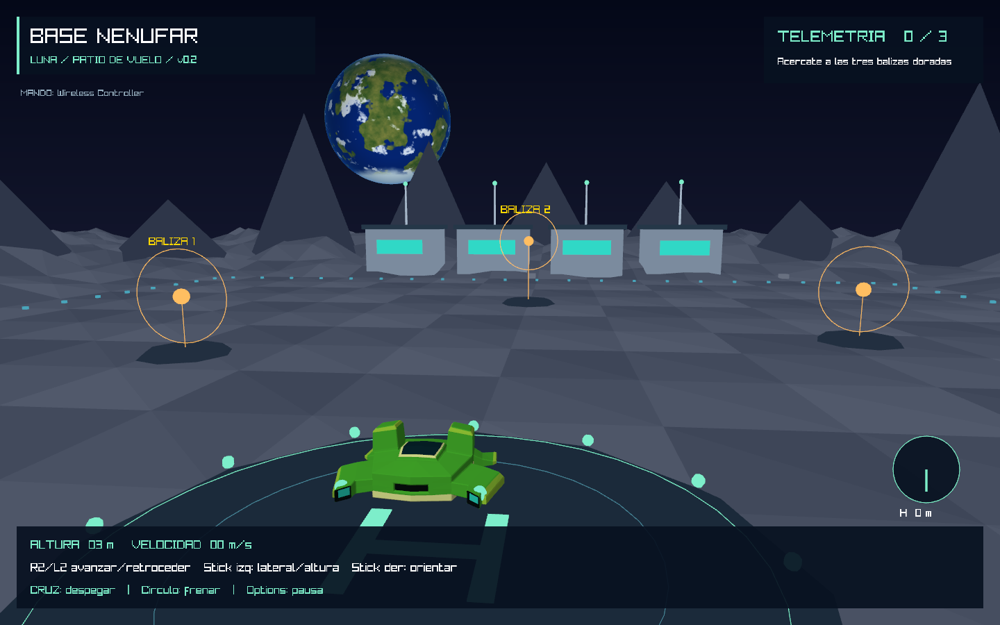
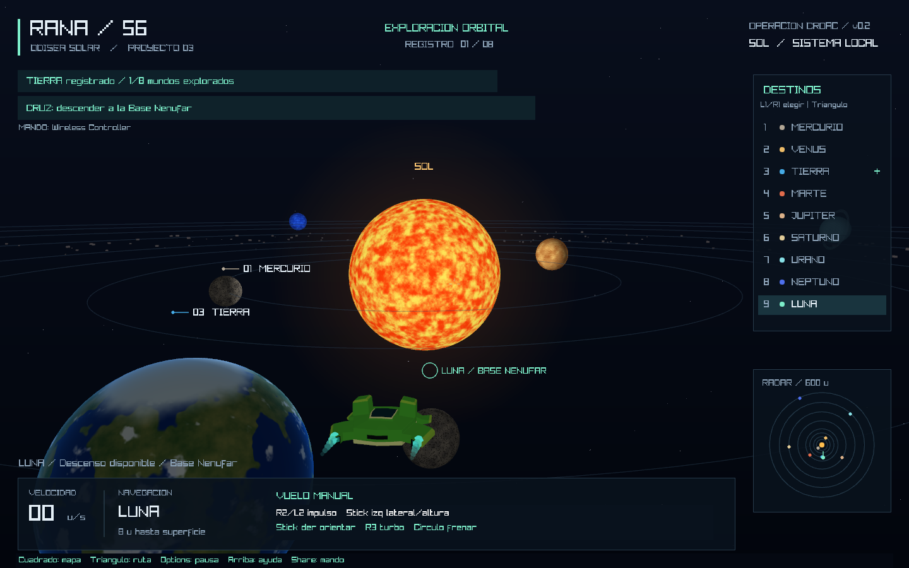
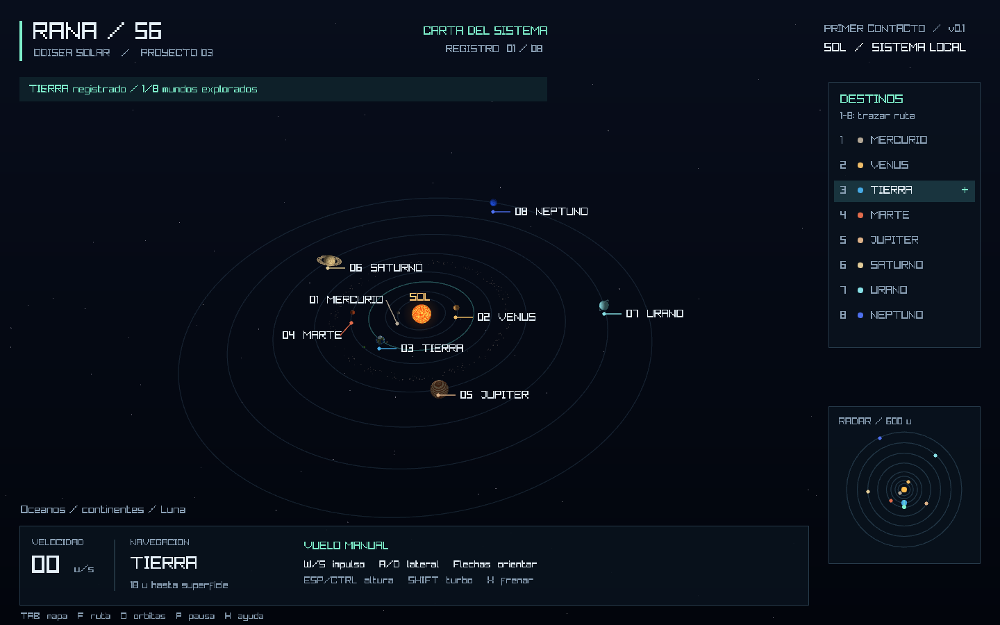

# RANA / 56 — Operación Croac

**Proyecto 3 · Versión 0.2.0 · Viaje y descenso lunar**
Juan Jose Rivas Alvarez · Carnet 24856

Exploración espacial en **Rust y raylib 6.0.0**, con la nave RANA-56 creada en Blender para el Laboratorio 3. Esta versión conecta el sistema solar con un escenario lunar: viaja, desciende con una animación, activa tres balizas y vuelve al espacio. Recomendada para mando, con controles completos de teclado como alternativa.



## Probar la versión 0.2

1. Conecta el DualShock 4 por USB y abre `rana-solar.exe` del paquete Windows, conservando `assets` junto al ejecutable.
2. La **Luna** está seleccionada al empezar. Pulsa **Triángulo / F** para viajar automáticamente.
3. Al llegar, pulsa **Cruz / E** cuando aparezca la indicación de descenso. Si llegaste manualmente, frena por debajo de 8 u/s.
4. En la **Base Nenúfar**, pilota la nave hacia las tres balizas doradas. Se activan al acercarte y cambian a verde.
5. Vuelve a la plataforma **H**, reduce velocidad y pulsa **Cruz / E** para despegar. La brújula de la esquina apunta a la plataforma.
6. Al regresar al espacio con las tres balizas activadas aparece la confirmación de prueba completada.

Puedes volver al espacio antes de completar las balizas y continuar la visita después. El avance permanece durante la sesión. El descenso está habilitado en la Luna; los ocho planetas siguen disponibles para vuelo orbital. La astronauta caminando y los rescates corresponden a las próximas versiones.



## Mando DualShock 4 / DualSense

Se utilizan los mapeos estándar de GLFW incluidos en raylib. La versión se verificó con un **DualShock 4 detectado como Wireless Controller**, seis ejes, gatillos en reposo y sticks dentro de la zona muerta. El DualSense dispone de mapeo en la biblioteca, pero no se ha probado físicamente en esta sesión. La comodidad de vuelo y los botones quedan disponibles para la prueba del jugador.

| Mando PlayStation | Acción |
| --- | --- |
| R2 / L2 | Avanzar / retroceder con intensidad analógica |
| Stick izquierdo, horizontal | Desplazamiento lateral |
| Stick izquierdo, vertical | Subir / bajar |
| Stick derecho | Girar e inclinar la nave |
| R3, mantener | Turbo |
| Círculo, mantener | Frenar |
| L1 / R1 | Elegir destino anterior / siguiente |
| Triángulo | Iniciar o cancelar la ruta automática |
| Cruz | Descender / despegar cuando aparece el aviso |
| Cuadrado | Mapa del sistema |
| Options | Pausa y menú |
| Cruceta arriba | Ayuda |
| Share / Create | Diagnóstico de mando |
| Cruceta arriba/abajo + Cruz | Seleccionar y confirmar opciones del menú |
| Círculo | Cerrar ayuda o volver desde el menú |

La conexión se detecta sin reiniciar. Desconectar el mando o quitar el foco de la ventana pausa el juego. Los sticks usan una zona muerta radial del 18 %. **Share / F3** muestra ejes y botones en vivo mientras detiene el juego. Se recomienda USB para la primera prueba; Bluetooth depende del reconocimiento del dispositivo por Windows. No se han añadido vibración ni gatillos adaptativos.

## Escenario

- Sol animado con iluminación sobre los planetas.
- Mercurio, Venus, Tierra, Marte, Júpiter, Saturno, Urano y Neptuno, cada uno con superficie procedural propia.
- Continentes, océanos, nubes y casquetes para la Tierra; bandas para los gigantes gaseosos; anillos para Saturno y Urano.
- Luna y cinturón de asteroides decorativo.
- Órbitas y rotación animadas, fondo de estrellas y vista general del sistema.
- Nave original en OBJ con los siete materiales de color base y estelas de los motores.
- Radar, selección de destinos, indicador de velocidad y registro de ocho mundos explorados.

Las dimensiones, distancias y velocidades son **escalas artísticas para jugar**, no una simulación astronómica a escala real. Los asteroides son decorativos; el Sol, los planetas y la Luna sí impiden atravesar su superficie. La exploración se conserva durante la sesión y se reinicia al cerrar el juego.



## Jugar

Se inicia cerca de la Tierra con la Luna seleccionada. Acércate a cada planeta para registrar una visita. Las teclas **1 a 8** activan una ruta automática al planeta correspondiente y **9** viaja a la Luna; cualquier entrada de movimiento devuelve el control manual.

| Control | Acción |
| --- | --- |
| W / S | Impulso hacia adelante / atrás |
| A / D | Desplazamiento lateral |
| Flechas izquierda / derecha | Girar la nave |
| Flechas arriba / abajo | Inclinar el rumbo |
| Espacio / Ctrl izquierdo | Subir / bajar |
| Shift izquierdo | Turbo |
| X | Frenar |
| 1–8 | Viajar a Mercurio–Neptuno |
| 9 | Viajar a la Luna |
| [ / ] | Seleccionar destino anterior / siguiente |
| E | Descender en la Luna / despegar desde la plataforma H |
| F | Iniciar o cancelar ruta al destino seleccionado |
| Tab | Alternar mapa general y tercera persona |
| O | Mostrar u ocultar órbitas |
| P / Escape | Pausar y abrir el menú |
| R | Reubicar la nave en el inicio orbital o en la plataforma lunar |
| H | Mostrar u ocultar ayuda |
| F12 | Guardar `screenshots/captura.png` |
| F3 | Mostrar diagnóstico del mando |

Para salir, selecciona **Salir del juego** en el menú de pausa. La ayuda y el diagnóstico detienen la simulación. La reubicación conserva las visitas y balizas de la sesión.

El piloto automático asciende a un plano de crucero, viaja sobre las órbitas y desciende cerca del planeta. Sigue su posición mientras avanza la simulación. El vuelo manual tiene aceleración suave, frenado y protección contra colisiones con cuerpos celestes.

## Compilar

Requisitos:

- Rust 1.88 o posterior y Cargo.
- CMake y herramientas de compilación C/C++ para construir raylib.
- LLVM/libclang para los bindings nativos.
- GPU/controlador compatible con OpenGL 3.3.

En Windows, usar Visual Studio 2022 con la carga de trabajo de C++, CMake y LLVM. Desde esta carpeta:

```powershell
cargo run --release
```

Si CMake o libclang no están en las rutas de búsqueda, el script de ayuda localiza las instalaciones habituales de Visual Studio y LLVM:

```powershell
.\jugar.ps1
```

La primera compilación necesita descargar las dependencias de Cargo. Se incluye `Cargo.lock` para fijar las versiones. No es necesario tener Blender instalado para ejecutar el juego.

Para llevar el ejecutable a otra carpeta, copiar `target/release/rana-solar.exe` **junto a la carpeta `assets`**. El OBJ y el MTL deben conservar sus nombres. Los shaders se incluyen en el ejecutable al compilar.

## Capturas reproducibles

```powershell
cargo run --release -- --hidden --frames 8 --capture screenshots/vuelo.png
cargo run --release -- --hidden --frames 8 --overview --capture screenshots/sistema.png
cargo run --release -- --hidden --frames 8 --planet 6 --capture screenshots/saturno.png
cargo run --release -- --hidden --lunar --frames 8 --capture screenshots/luna-v02.png
cargo run --release -- --hidden --near-moon --frames 8 --capture screenshots/descenso-v02.png
cargo run --release -- --hidden --controller-report --frames 8 --capture target/mando.png
cargo run --release -- --hidden --smoke-tour --capture target/recorrido.png
```

`--hidden` crea una ventana oculta, pero sigue necesitando un contexto gráfico OpenGL. `--planet 1..8`, `--lunar` y `--near-moon` son posiciones de inspección. `--smoke-tour` ejecuta automáticamente la ruta lunar, ambas animaciones y el recorrido de balizas; termina con error si no completa la ida y vuelta. Estas opciones son herramientas de verificación, independientes de los controles normales.

## Código

| Archivo | Responsabilidad |
| --- | --- |
| `src/main.rs` | Ventana, teclado, bucle, cámara y capturas. |
| `src/simulation.rs` | Órbitas, vuelo, colisiones, rutas y visitas. |
| `src/scene.rs` | Modelos, estrellas, anillos, radar e interfaz. |
| `src/controls.rs` | Teclado, mando, zonas muertas y acciones compartidas. |
| `src/expedition.rs` | Estados de descenso, superficie y ascenso; balizas. |
| `src/lunar.rs` | Escenario, cámara y señalización de la Base Nenúfar. |
| `src/interface.rs` | Indicaciones, menú de pausa, ayuda y diagnóstico. |
| `assets/shaders/world.vs` | Transformación de vértices y normales. |
| `assets/shaders/world.fs` | Superficies procedurales, iluminación y atmósferas. |
| `assets/RANA_56.obj` | Malla original de la nave rana. |

## Verificación

```powershell
cargo test --release
cargo clippy --release -- -D warnings
cargo fmt --check
```

Las 11 pruebas cubren las órbitas, colisiones, llegada del piloto automático a los planetas y la Luna, condiciones de descenso, ida y vuelta, pausa, límites lunares, zonas muertas, cancelación manual, consistencia del movimiento y proyección. Además se ejecuta el recorrido gráfico completo con los shaders reales.

Tecnología: [raylib](https://www.raylib.com/) y [raylib-rs](https://github.com/raylib-rs/raylib-rs). Todo el escenario se genera en código; no se descargan texturas durante el juego.
