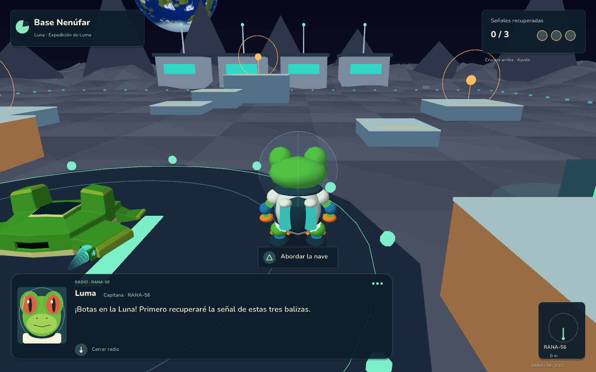
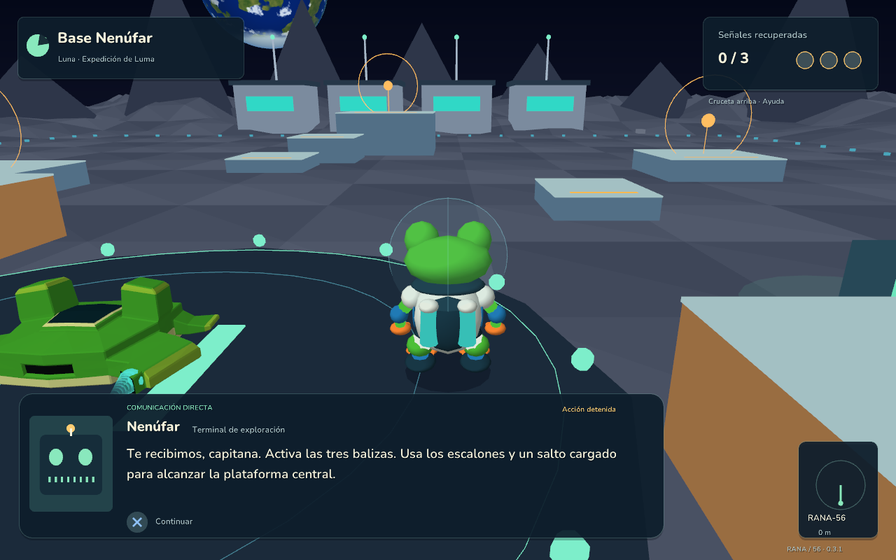
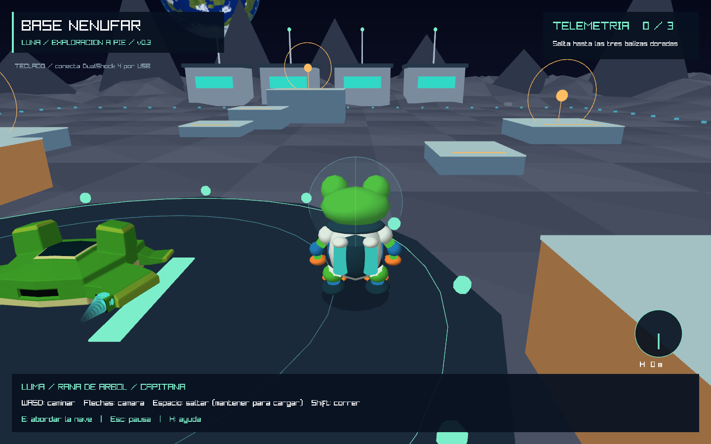

# RANA / 56 — Operación Croac

**Proyecto 3 · Versión 0.3.1 · HUD y comunicaciones**

Juan Jose Rivas Alvarez · Carnet 24856

Aventura del sistema solar en **Rust y raylib 6.0.0**. Pilota la nave RANA-56, aterriza en la Luna y explora a pie con **Luma**, una rana de árbol de ojos rojos con traje espacial. La versión 0.3 agrega movimiento, saltos, cámara, animaciones y un circuito de plataformas para probarlos.



## Hotfix 0.3.1: HUD y radio

- Tipografía redondeada Nunito, con pesos distintos para títulos y texto, acentos y filtrado suave.
- Paneles compactos, colores crema/menta/dorado y detalles de nenúfar. Los controles completos viven en la ayuda.
- A pie: ubicación, tres señales, orientación hacia la nave y acciones cercanas. La barra de salto solo aparece al cargar.
- En vuelo: destino, distancia, velocidad, impulso y radar. La lista de destinos se muestra dentro del mapa.
- Símbolos de los botones PlayStation dibujados en código. Los avisos cambian entre mando y teclado según el último dispositivo utilizado.
- Caja de comunicaciones inspirada en los juegos de aventura espacial de N64: retrato animado, nombre, función, texto progresivo y aviso de avance.
- Mensajes de radio por eventos de Luma: salida, aprendizaje del salto, balizas y final del circuito. Se encolan y se emiten una sola vez por sesión.
- Aviso breve con retrato al conectar una baliza.

### Probar las comunicaciones

La **radio** permite seguir jugando. Pulsa **cruceta abajo / Enter** para completar el texto; vuelve a pulsar para cerrar ese mensaje. También desaparece automáticamente después de dejar tiempo para leerlo.

Para una **conversación directa**, camina hacia la terminal de pantalla verde, unos pasos a la derecha de la nave, y pulsa **Triángulo / E** cuando aparezca «Hablar con la base». La acción se detiene mientras lees. Pulsa **X / Enter** para completar el texto y vuelve a pulsar para avanzar. Al terminar recuperas el control. Una radio interrumpida por una conversación conserva su progreso y continúa después.

El sistema guarda el personaje, su función y retrato por mensaje para incorporar a los tripulantes en futuras versiones. Esta entrega contiene a Luma y a la terminal Nenúfar; los rescates siguen previstos para las siguientes versiones. No incluye voces grabadas.



## Qué incluye la versión 0.3

- Personaje 3D generado en código: piel verde, ojos rojos, detalles azules, dedos naranjas, mochila de oxígeno y casco transparente.
- Animaciones de reposo, respiración, parpadeo, caminar/correr, preparación del salto, vuelo y amortiguación al aterrizar.
- Movimiento relativo a la cámara, carrera analógica, salto corto y salto cargado.
- Colisiones con suelo, paredes, nave y plataformas; cámara que se acerca para evitar obstáculos.
- Salida automática de la nave después del descenso y animación para volver a abordar.
- Tres balizas que se activan **a pie**, con escalones y plataformas de diferentes alturas.
- Vuelo orbital y lunar, mando PlayStation, ayuda, pausa y diagnóstico de la versión 0.2.1.

El circuito es una zona de práctica de la astronauta. Los rescates de la tripulación y sus celebraciones corresponden a las próximas versiones. Las visitas y balizas se mantienen durante la sesión; todavía no hay guardado en disco.



## Probar hoy

En la carpeta local `dist/RANA56-v0.3.1/`:

- Abre **`rana-solar.exe`** para empezar en el sistema solar.
- Abre **`ExplorarLaLuna.cmd`** para comenzar directamente junto a la nave y probar a Luma.
- Conserva `assets` junto al ejecutable. Cada versión tiene su propia carpeta.

Recorrido completo:

1. La Luna comienza seleccionada. Pulsa **Triángulo / F** para viajar automáticamente.
2. Al llegar, pulsa **X / E** para descender. El vuelo manual requiere estar cerca y por debajo de 8 u/s.
3. Tras aterrizar, Luma sale de la nave automáticamente.
4. Camina por la base, salta a las plataformas y activa las tres balizas doradas. La central se alcanza desde los escalones con un salto cargado.
5. Regresa al lado derecho de la nave, donde saliste. Pulsa **Triángulo / E** para abordar cuando aparezca el aviso.
6. Ya en cabina, pulsa **X / E** para despegar. También puedes volver a salir con **Cuadrado / Q** mientras estás en H.

Puedes regresar al espacio sin completar el circuito y volver más tarde en la misma sesión. Si te atoras, el menú de pausa permite reubicar a la astronauta o la nave conservando el progreso.

## Controles a pie

| Acción | DualShock 4 / DualSense | Teclado |
| --- | --- | --- |
| Caminar, según la cámara | Stick izquierdo | W / A / S / D |
| Girar e inclinar la cámara | Stick derecho | Flechas |
| Correr | Mantener R2 | Mantener Shift |
| Salto corto | Tocar X y soltar | Tocar Espacio y soltar |
| Salto cargado | Mantener X y soltar | Mantener Espacio y soltar |
| Abordar, cerca de la nave | Triángulo | E |
| Pausa y menú | Options | Escape / P |
| Ayuda | Cruceta arriba | H |
| Diagnóstico de mando | Share / Create | F3 |
| Hablar con la terminal | Triángulo | E |
| Completar / avanzar conversación | X | Enter |
| Completar / cerrar radio | Cruceta abajo | Enter |
| Reubicar | Menú de pausa | R |

Al cargar el salto, Luma se agacha y aparece una barra. A la carga máxima el salto se ejecuta automáticamente. Mantener el botón después no provoca saltos repetidos. El stick conserva su intensidad analógica para caminar despacio o a velocidad completa.

## Controles de vuelo

| Acción | Mando PlayStation | Teclado |
| --- | --- | --- |
| Avanzar / retroceder | R2 / L2 | W / S |
| Orientación suave | Stick izquierdo | — |
| Orientación directa | Stick derecho | Flechas |
| Turbo | R3 | Shift |
| Frenar | Círculo | X |
| Elegir destino | L1 / R1 | [ / ] |
| Trazar / cancelar ruta | Triángulo | F |
| Ruta directa | — | 1–8: planetas; 9: Luna |
| Descender / despegar | X | E |
| Salir de la nave en H | Cuadrado | Q |
| Mapa orbital | Cuadrado | Tab |
| Desplazamiento lateral / vertical | — | A/D / Espacio,Ctrl |
| Captura | — | F12 |

En vuelo, los sticks orientan la nave; los gatillos controlan el avance. Las estelas comparten la transformación de la nave y permanecen ancladas a sus motores.

La conexión de mando se detecta sin reiniciar. Los sticks usan zona muerta radial del 18 %. Desconectar el mando o quitar el foco de la ventana pausa la partida. Para salir, utiliza el menú de pausa. No se incluyen vibración ni gatillos adaptativos.

El DualShock 4 fue detectado y comprobado en versiones anteriores. En la revisión gráfica de la versión 0.3 no había mando conectado; el nuevo mapeo a pie está disponible para la prueba del jugador.

## Sistema solar

Se conservan el Sol, Mercurio, Venus, Tierra, Marte, Júpiter, Saturno, Urano, Neptuno, la Luna, anillos y asteroides. Los planetas tienen superficies procedurales y órbitas animadas. La nave utiliza el OBJ original del Laboratorio 3 y sus materiales de color base.

Las dimensiones y velocidades son escalas artísticas para jugar. El descenso está habilitado en la Luna; los otros planetas siguen disponibles para explorar en órbita. Los asteroides son decorativos.

## Compilar

Requisitos: Rust 1.88 o posterior, Cargo, CMake, herramientas C/C++ y LLVM/libclang para construir raylib; un controlador gráfico compatible con OpenGL 3.3 para jugar.

En Windows puede utilizarse Visual Studio 2022 con C++, CMake y LLVM. Desde la raíz:

```powershell
cargo run --release --locked
```

El script ayuda a localizar las instalaciones habituales de CMake y libclang:

```powershell
.\jugar.ps1
```

La primera compilación descarga las dependencias de Cargo. `Cargo.lock` fija las versiones. Blender no es necesario para jugar. Para mover el ejecutable compilado, copia `target/release/rana-solar.exe` y `assets` a la misma carpeta. Los shaders se incluyen al compilar.

## Verificación

```powershell
cargo test --release
cargo clippy --release --all-targets -- -D warnings
cargo fmt --check
```

Las 21 pruebas cubren navegación, motores, movimiento a pie a distintas tasas de cuadros, paredes, aterrizaje sobre plataformas, obstrucción de cámara, salto corto/cargado, prevención de saltos repetidos, pausa y ciclo completo de salida y abordaje. Las nuevas pruebas verifican texto Unicode, cola de mensajes, prevención de repeticiones y recuperación de una radio tras una conversación. Una prueba recorre las tres balizas mediante los controles de caminar y saltar, sin cambiar artificialmente la posición del personaje.

Capturas y recorrido gráfico reproducibles:

```powershell
cargo run --release -- --hidden --portrait --frames 8 --capture screenshots/luma-v03.png
cargo run --release -- --hidden --walking --frames 8 --capture screenshots/exploracion-v03.png
cargo run --release -- --hidden --smoke-tour --capture target/recorrido-v03.png
cargo run --release -- --hidden --radio-preview --pad-preview --frames 8 --capture screenshots/radio-v031.png
cargo run --release -- --hidden --dialogue-preview --compact --pad-preview --frames 8 --capture screenshots/dialogo-v031.png
cargo run --release -- --hidden --overview --frames 8 --capture screenshots/mapa-v031.png
```

`--smoke-tour` verifica viaje orbital, descenso, salida, una conversación completa, circuito a pie con saltos, abordaje y ascenso. Termina con error si no completa el recorrido o el diálogo. `--hidden` necesita igualmente un contexto OpenGL. `--portrait` es una pose de inspección; `--walking` entra directamente a la zona a pie. Se conservan `--lunar`, `--near-moon`, `--planet 1..8`, `--overview`, `--controller-report` y `--flight-check` para revisión. Las opciones de preview muestran las comunicaciones completas; `--compact` comprueba 1280 × 800. `--pad-preview` dibuja símbolos de mando sin simular un dispositivo físico; en una partida normal los avisos siguen el dispositivo utilizado.

## Código

| Archivo | Responsabilidad |
| --- | --- |
| `src/main.rs` | Ventana, bucle, cámara y acciones según el modo. |
| `src/astronaut.rs` | Movimiento, saltos, colisiones y cámara a pie. |
| `src/frog.rs` | Modelo procedural y animaciones de Luma. |
| `src/expedition.rs` | Descenso, salida, exploración, abordaje y ascenso. |
| `src/controls.rs` | Teclado, mando y zonas muertas. |
| `src/lunar.rs` | Base, plataformas, balizas e indicadores. |
| `src/scene.rs` | Planetas, estrellas y recursos gráficos. |
| `src/ship.rs` | Transformación compartida de nave y motores. |
| `src/simulation.rs` | Órbitas, vuelo, piloto automático y colisiones orbitales. |
| `src/ui.rs` | Tipografía, paneles y símbolos de botones. |
| `src/hud.rs` | HUD contextual, retratos, ayuda y pausa. |
| `src/comms.rs` | Radio, conversaciones, eventos y cola de mensajes. |
| `assets/fonts/` | Nunito, variantes estáticas y licencia OFL. |
| `assets/shaders/` | Superficies procedurales e iluminación. |

Tecnología: [raylib](https://www.raylib.com/) y [raylib-rs](https://github.com/raylib-rs/raylib-rs). No se descargan texturas durante el juego.

Tipografía: [Nunito, de The Nunito Project Authors](https://github.com/google/fonts/tree/main/ofl/nunito), bajo SIL Open Font License 1.1. Se incluyen la licencia, el archivo original y variantes estáticas de pesos 600/800 preparadas con FontTools. Las herramientas de preparación no son necesarias para compilar ni jugar.
